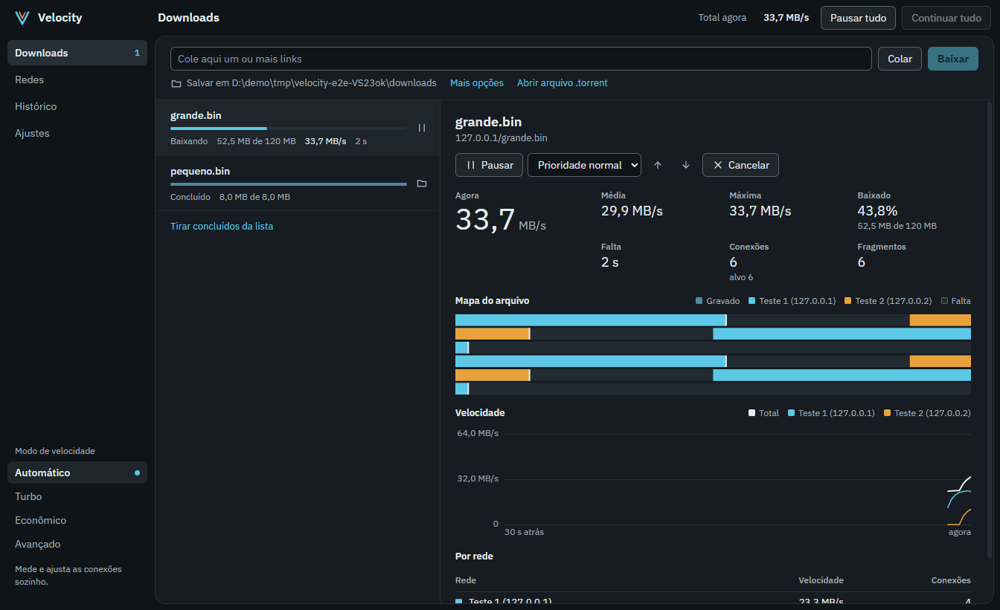
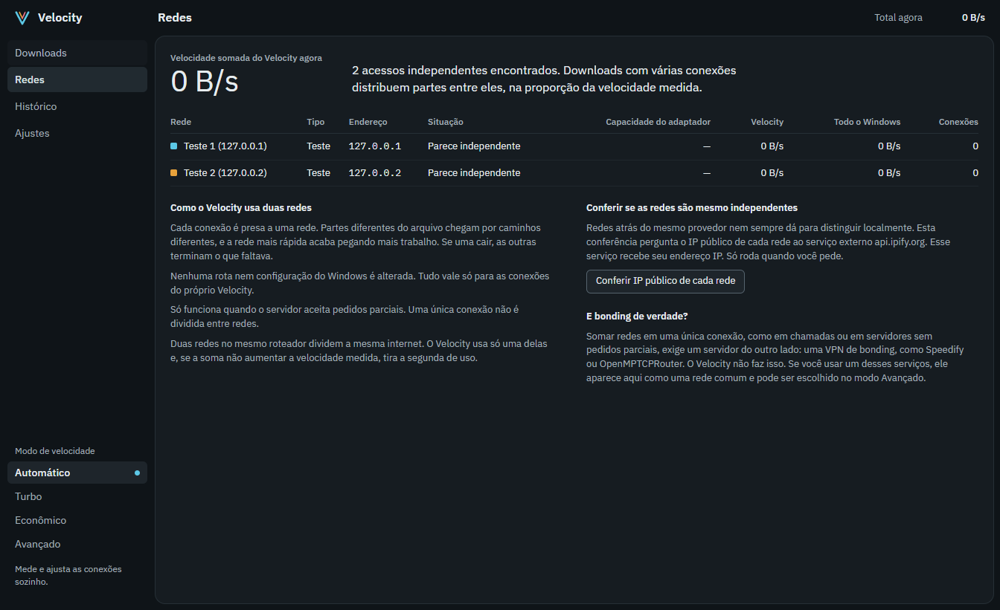
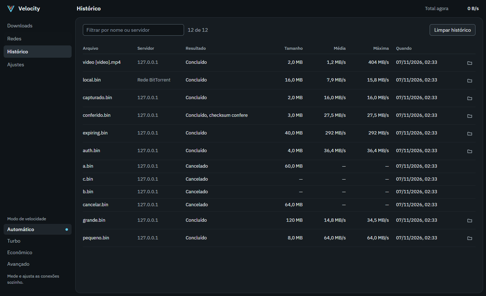

# Velocity

Gerenciador de downloads para Windows 11. Interface em Electron, React e TypeScript. Motor em .NET 8.

## Capturas de tela







Imagens feitas com um servidor local de teste.

## Instalar

Baixe na aba [Releases](https://github.com/Henriquehoff4/velocity/releases):

- `Velocity Setup 1.0.0.exe`: instalador (na aba Releases o GitHub mostra como `Velocity.Setup.1.0.0.exe`).
- `Velocity-1.0.0-portatil.exe`: não precisa de instalação.

O executável não tem assinatura digital, então o SmartScreen pode avisar na primeira vez. Clique em "Mais informações" e "Executar assim mesmo".

## Comandos

```
npm install
node node_modules/electron/install.js
npm run tools
npm run build:engine
npm start
```

- `npm run test:all`: typecheck, unidade, motor e Electron real, com servidores HTTP locais.
- `npm run test:packaged`: testa `release/win-unpacked`.
- `npm run bench`: compara GET convencional, Velocity e aria2 em servidor local.
- `npm run bench -- --url <link> --authorized`: benchmark externo opcional, consome banda de verdade.
- `npm run dist`: gera o instalador e o portátil em `release/`.

## Arquitetura

- `src/renderer`: interface. Só fala com o motor pela lista de comandos do preload.
- `src/main`: janela, IPC, inicialização do motor e servidor local de captura do navegador.
- `engine/Velocity.Engine/Core`: fragmentação, controle de conexões, journal, disco.
- `engine/Velocity.Engine/Net`: monitor de redes, sockets presos a cada interface, HTTP.
- `engine/Velocity.Engine/Persist`: fila, histórico, ajustes, senhas protegidas por DPAPI.
- `engine/Velocity.Engine/Tools`: aria2 para torrents e yt-dlp para vídeo.
- `browser-extension`: extensão MV3 opcional.

O motor conversa com a interface por NDJSON em stdin e stdout.

## Integridade

Cada trecho gravado tem um hash XxHash3 registrado em um journal `.vdl`. Ao terminar, o arquivo é relido e comparado, e o que não confere é baixado de novo. Com a conferência desligada no modo Avançado, cada checkpoint força a gravação em disco. Isso protege contra erro de disco e queda de energia, não contra um servidor que entrega o arquivo errado. Para isso, informe o checksum.

## Licença

MIT. Veja `LICENSE`. Ferramentas de terceiros incluídas nos instaladores (aria2, GPL-2.0-or-later; yt-dlp, Unlicense): veja `THIRD-PARTY-NOTICES.md`.
